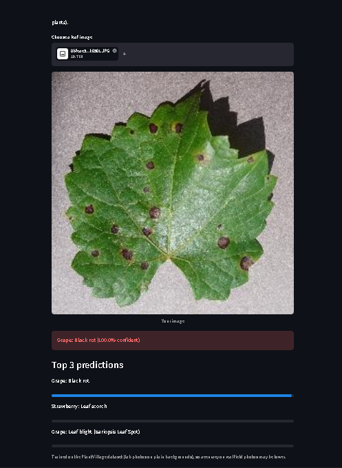
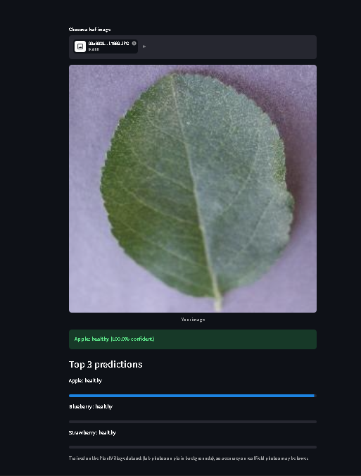
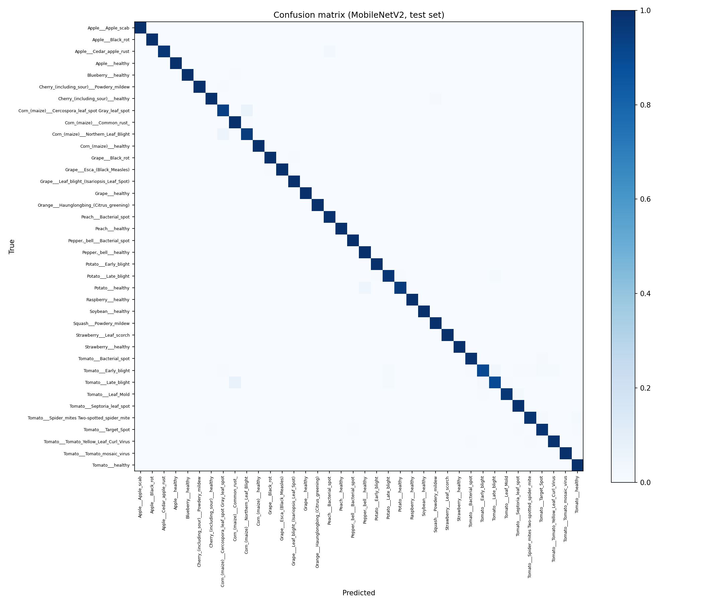
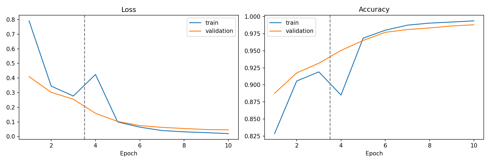

# 🌿 Plant Disease Detection with PyTorch

Classifies a leaf photo into one of **38 plant-disease classes (14 plants)** using a CNN built from scratch and a fine-tuned MobileNetV2, with a Streamlit web app.

## Demo
| Disease detected | Healthy leaf |
|---|---|
|  |  |

## Dataset
[PlantVillage](https://www.kaggle.com/datasets/abdallahalidev/plantvillage-dataset): 54,305 color leaf images, 38 classes. Split 70% train / 15% validation / 15% test (stratified, so every class appears in all three).

## Method
- Images resized to 128×128, normalized with ImageNet statistics.
- Augmentation on the training set only: flip, rotation (±20°), brightness and contrast.
- Class-weighted loss, because classes are uneven (from 152 to 5,507 images).
- **Baseline:** 4-block CNN trained from scratch (10 epochs).
- **Transfer learning:** pretrained MobileNetV2, 3 epochs training only the new head, then 7 epochs fine-tuning everything with a smaller learning rate.
- Trained on a free Colab T4 GPU.

## Results (test set, 8,146 unseen images)
| Model | Accuracy | Macro F1 |
|---|---|---|
| Baseline CNN | 95.09% | 0.9413 |
| **MobileNetV2 (fine-tuned)** | **98.70%** | **0.9827** |

Biggest gains (recall, baseline → MobileNetV2): Tomato Target Spot 0.564 → 0.981, Potato healthy 0.739 → 0.957, Tomato Spider mites 0.845 → 0.980.
Weakest classes now: Tomato Late blight (0.892) and Tomato Early blight (0.900).




## Limitations
- PlantVillage photos are taken in a lab on plain backgrounds, so accuracy on real field photos is likely lower.
- The dataset has several photos of the same leaf. A random split may put near-copies in both train and test, so the scores can be optimistic.
- The model can be highly confident even on images unlike its training data.

## Run it locally
```bash
git clone https://github.com/Its-Niraj-Code-Hub/plant-disease-cnn.git
cd plant-disease-cnn
pip install -r requirements.txt
python -m streamlit run app.py
```

## Project structure
```
app.py            Streamlit app
models/           trained MobileNetV2 weights
notebooks/        full training notebook (Colab)
outputs/          graphs and screenshots
```